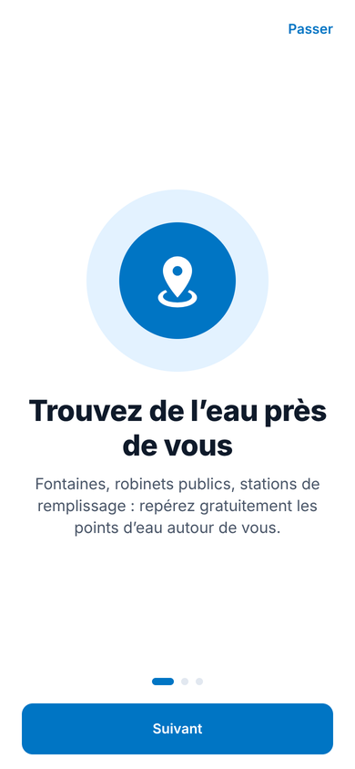
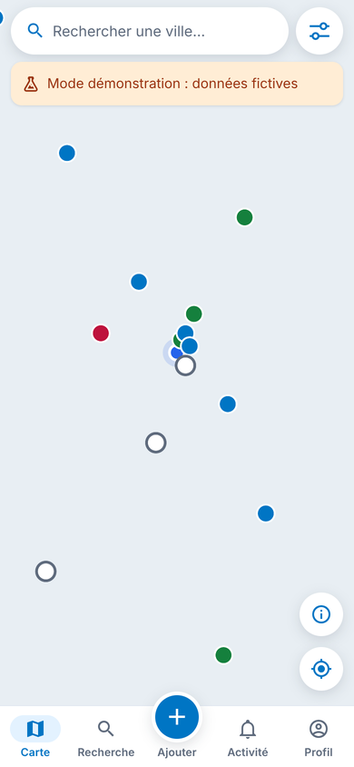
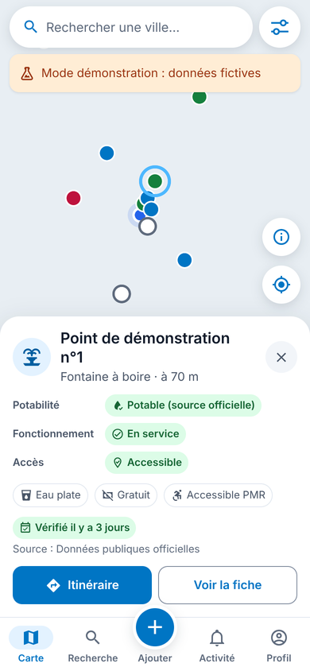
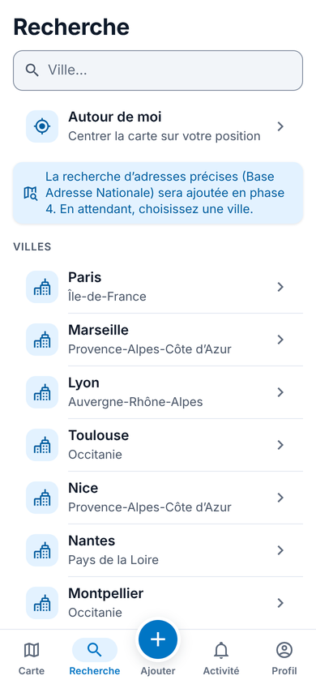
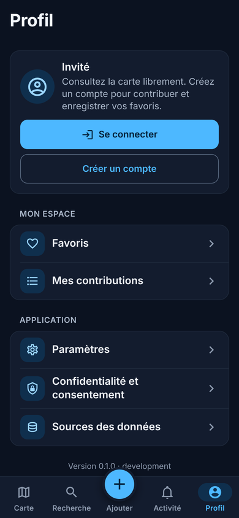

# Water Finder

Application mobile (iOS / Android) gratuite pour **trouver les points d'eau potable à proximité** :
fontaines, robinets publics, stations de remplissage. Elle s'appuie sur trois sources : données
publiques officielles, OpenStreetMap et contributions de la communauté. Elle sera financée par la
publicité, avec consentement.

Priorité géographique : la France, avec une architecture prévue pour l'international.
Publication visée : **juin 2027**.

> **État actuel : phase 1 terminée** (initialisation, architecture, navigation, design system,
> première carte, services de géolocalisation). Aucune donnée réelle de point d'eau n'est encore
> branchée : le backend arrive en phase 2 et les imports officiels/OSM en phase 3.
> Voir [PROGRESS.md](PROGRESS.md).

| Onboarding                                      | Carte (mode démo)                               | Panneau d'un point                                       | Recherche                                      | Profil (sombre)                                    |
| ----------------------------------------------- | ----------------------------------------------- | -------------------------------------------------------- | ---------------------------------------------- | -------------------------------------------------- |
|  |  |  |  |  |

_Captures du build web de test. Les points visibles sont des **données fictives** (mode
démonstration de développement, signalé par un bandeau) affichées sur un fond de carte vide :
l'environnement de développement n'avait pas accès aux tuiles._

## Principes non négociables

- **Potabilité, fonctionnement et accès sont trois informations distinctes**, jamais confondues
  (modèle de domaine, interface, filtres).
- La potabilité n'est **certifiée** que par une source officielle ou une preuve sanitaire datée ;
  un avis utilisateur ou un tag OpenStreetMap ne la certifie jamais (règle codée et testée dans
  `packages/core`).
- Une information inconnue ou ancienne est **affichée comme telle**.
- Localisation **au premier plan uniquement**, sans historique, jamais envoyée au serveur.
- Aucune donnée fictive ne remplace silencieusement des données réelles.
- Aucun secret dans le dépôt ni dans l'application.

## Démarrage rapide

```bash
# Node.js 22 et npm 10
npm install
npm run check          # formatage, types, lint et tests de tout le monorepo
npm run mobile:web     # aperçu web (http://localhost:8081)
```

L'application native utilise MapLibre (module natif) : elle nécessite un **development build**
(Expo Go ne suffit pas). Procédure complète : [SETUP.md](SETUP.md).

## Structure

```
water-finder/
├── apps/mobile/          Application Expo (React Native, Expo Router, TypeScript strict)
├── packages/core/        Domaine partagé : statuts, règles de potabilité, filtres, géo-utilitaires
├── docs/screenshots/     Captures de référence par phase
├── tools/                Outils (génération des icônes)
└── .github/workflows/    Intégration continue
```

## Documentation

| Document                           | Contenu                                                     |
| ---------------------------------- | ----------------------------------------------------------- |
| [SETUP.md](SETUP.md)               | Installation, lancement, development build, tests           |
| [ARCHITECTURE.md](ARCHITECTURE.md) | Stack, versions, organisation du code, décisions techniques |
| [DATABASE.md](DATABASE.md)         | Schéma PostgreSQL/PostGIS prévu (phase 2)                   |
| [DATA_SOURCES.md](DATA_SOURCES.md) | Sources de données, licences, état des vérifications        |
| [DEPLOYMENT.md](DEPLOYMENT.md)     | Environnements, EAS Build/Submit, stores, Vercel            |
| [SECURITY.md](SECURITY.md)         | Sécurité, confidentialité, permissions                      |
| [PROGRESS.md](PROGRESS.md)         | Avancement détaillé, tests exécutés, points bloquants       |
| [ROADMAP.md](ROADMAP.md)           | Les 8 phases jusqu'au lancement                             |

## Licence

Code propriétaire (tous droits réservés) en attendant une décision du porteur de projet. Les
données tierces restent soumises à leurs licences respectives (voir
[DATA_SOURCES.md](DATA_SOURCES.md)).
